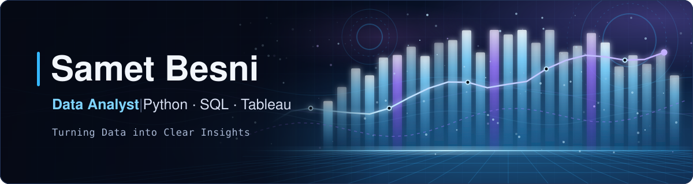
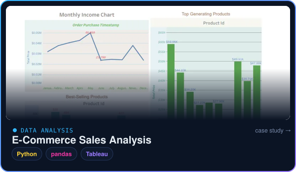
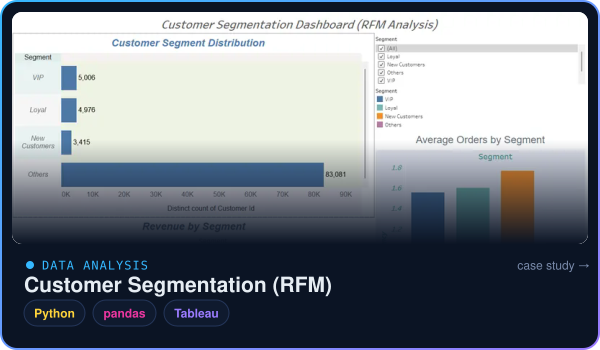
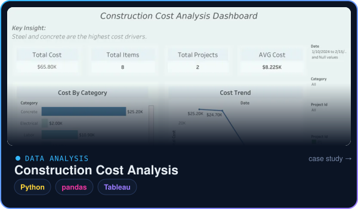
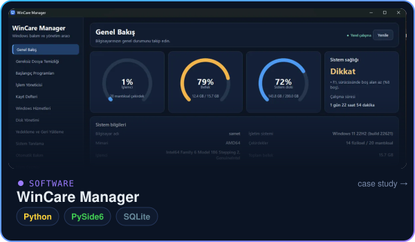
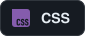

Hello! I'm Samet, an Electrical-Electronics Engineering graduate focused on data analysis and visualization.
I use Python, SQL, Excel and Tableau to clean data, explore trends, and turn findings into clear dashboards and practical insights.
Here you'll find selected data analysis case studies and software projects.

> **Türkçe:** Merhaba, ben Samet. Elektrik-Elektronik Mühendisliği mezunuyum ve veri analizi ile görselleştirmeye odaklanıyorum.
> Python, SQL, Excel ve Tableau kullanarak verileri temizliyor, analiz ediyor ve bulguları anlaşılır panolara dönüştürüyorum.
> Burada seçilmiş veri analizi çalışmalarıma ve yazılım projelerime ulaşabilirsiniz.

🌐 **Portfolio:** [digital-universe-6p0.pages.dev](https://digital-universe-6p0.pages.dev/) — case studies, an interactive data lab and an SQL challenge, in English and Turkish.

### Featured Projects

  
  

  
  

- **E-Commerce Sales Analysis** — about 100K orders from the Olist Brazilian e-commerce dataset, cleaned and joined to analyse revenue, top products and seasonality. [Case study](https://digital-universe-6p0.pages.dev/en/projects/ecommerce-sales-analysis) · [Dashboard](https://public.tableau.com/app/profile/samet.besni/viz/E-CommerceSalesDashboard_17764228825900/E-CommerceSalesDashboard)
- **Customer Segmentation (RFM)** — Recency, Frequency and Monetary scores combined into VIP, Loyal, New and Other segments; the case study lists the method's current limitations (order-level customer IDs) and a person-level revision is planned. [Case study](https://digital-universe-6p0.pages.dev/en/projects/rfm-customer-segmentation) · [Dashboard](https://public.tableau.com/app/profile/samet.besni/viz/Customer-Segmentation-Dashboard-RFMAnalysis/CustomerSegmentationDashboardRFMAnalysis)
- **Construction Cost Analysis** — a sample construction cost sheet analysed by concrete, steel, labour, electrical and mechanical items. [Case study](https://digital-universe-6p0.pages.dev/en/projects/construction-cost-analysis) · [Dashboard](https://public.tableau.com/app/profile/samet.besni/viz/Construction-Dashboard/Dashboard1)
- **WinCare Manager** — offline, safe maintenance tool for Windows 10/11; dry-run by default, every change backed up and reversible. [Repository](https://github.com/sametbesni/WinCare-Manager) · [Case study](https://digital-universe-6p0.pages.dev/en/projects/wincare-manager)

### Skills

**Data & Analytics**

  
  
  
  
  
  
  
  

**Development**

  
  
  
  
  
  
  

### Education & Certificate

- **Erciyes University** — Electrical-Electronics Engineering, 2019
- **GoIT** — Data Analytics certificate, 2025 ([PDF](https://digital-universe-6p0.pages.dev/certificates/goit-data-analytics.pdf))

### Contact

[Portfolio](https://digital-universe-6p0.pages.dev/) · [LinkedIn](https://www.linkedin.com/in/samet-besni/) · [Upwork](https://www.upwork.com/freelancers/~01d6268cbafe0854c2) · [Email](mailto:sametbesni@gmail.com)

Open to freelance data work: cleaning, analysis and KPI dashboards. · Veri temizleme, analiz ve KPI panosu işleri için Upwork veya e-posta ile ulaşabilirsiniz.
