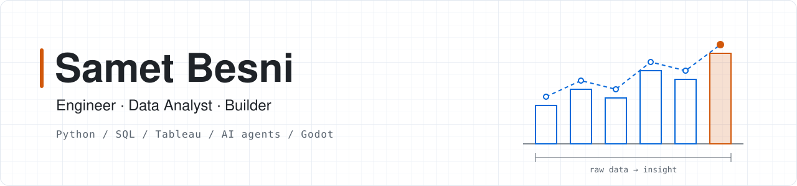

<picture>
  <source media="(prefers-color-scheme: dark)" srcset="assets/header-dark.svg">
  
</picture>
  

I'm an engineer who turns messy data into clear dashboards and builds small, careful tools in Python.
Lately I also work with AI agents and build a strategy game in Godot.

**Open to freelance data work:** cleaning, analysis and KPI dashboards in Excel or Tableau.
[Hire me on Upwork](https://www.upwork.com/freelancers/~01d6268cbafe0854c2)

> **Türkçe:** Mühendisim. Dağınık veriyi anlaşılır panolara dönüştürüyor, Python ile küçük ve özenli araçlar yazıyorum.
> Yapay zekâ ajanlarıyla çalışıyor, Godot ile bir strateji oyunu geliştiriyorum.
> Veri temizleme, analiz ve KPI panosu işleri için Upwork üzerinden ulaşabilirsiniz.

### Featured work

| Project | What it is | Built with |
|---|---|---|
| [E-Commerce Sales Dashboard](https://public.tableau.com/views/E-CommerceSalesDashboard_17764228825900/E-CommerceSalesDashboard) | ~100k marketplace orders cleaned and joined; revenue, top products and seasonality | Python, pandas, Tableau |
| [Construction Cost Dashboard](https://public.tableau.com/views/Construction-Dashboard/Dashboard1) | Where a construction budget actually goes, by material and phase | Python, Tableau |
| [WinCare Manager](https://github.com/sametbesni/WinCare-Manager) | Offline Windows maintenance app. Dry-run by default, every change backed up and reversible | Python, PySide6, SQLite |
| [Ajan Borsa](https://github.com/sametbesni/ajan-borsa) | One local Turkish dashboard for three open-source market agents (BIST and US) | Python, MCP, vectorbt |
| **Köy** (working title, in progress) | Original medieval economy strategy game for mobile: roads, carriers, production chains, hunger. 108 automated tests | Godot 4, GDScript |

### Latest on GitHub
<!-- repos:start -->
[WinCare-Manager](https://github.com/sametbesni/WinCare-Manager) - 2026-11-20 Windows 10/11 için çevrimdışı, güvenli bakım ve yönetim aracı (Pyth...

[ajan-borsa](https://github.com/sametbesni/ajan-borsa) - 2026-11-20 Üç açık kaynak borsa ajanını (borsa-mcp, day-trader-skill, vectorbt...
<!-- repos:end -->

### Toolbox

Also: pandas, Excel, Tableau, Claude Code. The list above refreshes daily with a <a href=".github/workflows/update-readme.yml">GitHub Action</a>.
